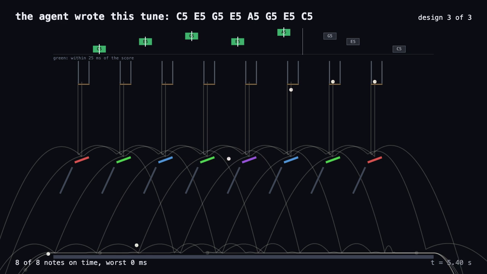

# The Tune Machine

An agent writes a short tune, then builds a marble machine in a physics engine that plays it. Every note you hear is a real marble hitting a real bar in the simulation, at the time the engine logged.

[](media/tune-machine-first-run.mp4)

Built on [goldberg-engine](https://github.com/abhaymettu/goldberg-engine), the sibling repo with the deterministic 2D physics, the renderer and the audio synth. This repo only reads that engine; it never edits it.

## What happened on the first real run (Oct 21, 2026, about 3am)

Command: `node bin/run.js --attempts 5`. It made 4 model calls (Sonnet through the local `claude` CLI) and took 100 seconds, clip included.

1. **The tune.** The model wrote "Marble Lullaby", 8 notes: C5 at 1 s, E5 2, G5 3, E5 4, A5 5, G5 6, E5 6.5 and C5 7.5.
2. **Design 1.** Eight one-marble hoppers, each over its own tilted bar. All 8 notes landed within 4 ms, but each marble bounced on and struck the next bar: 7 extra notes. It did not pass.
3. **Design 2.** The model tilted the bars the other way, so the marbles rolled left instead of right. Same problem in the other direction: still 7 extra notes.
4. **Design 3.** The model made the bars dead (restitution 0) and put a steep catch ramp under each one to carry the marble to the floor. It also measured the fall in its own geometry at 0.895 s from design 2's logged errors and moved every gate 12 ms earlier. The result was 8 of 8 notes, 0 extra, every onset exactly on the score, so the loop stopped.

The clip above is that run: the two failing designs play fast as faint ghosts, then the winner at real speed. Each note lights green at the moment its logged bar hit happens if it is within 25 ms of the score, red otherwise; extra hits show as red ticks.

## How it works

```
model writes tune -> model writes level -> engine simulates -> score onsets -> feedback -> ... -> reel -> recorder
```

- **The tune.** 4 to 8 notes, pitches C4 to C7, onsets 1 to 9 s. An invalid tune gets one retry with the validator's errors.
- **The design.** The model writes a whole `goldberg-level/1` level. House rules: fixed world, ceiling at y = 10.5 (kept clear for the piano roll), at most 40 parts and 16 marbles, plus one measured fact about the engine's fall times.
- **Scoring.** Hits are matched to notes of the same pitch in time order; a dynamic program prices unmatched notes and extra hits. Pass: no missing notes, no extra hits, mean error under 10 ms per note.
- **Feedback.** The next prompt carries the previous level, per-note signed errors, which marble hit which bar, every extra hit, and the best design so far.
- **The reel and clip.** The engine's player plays earlier designs as ghosts, then the winner at real speed, drawing only recorded frames. Audio is the engine's synth fed one sound per logged `bar-hit` of the winning run; nothing is placed by hand. Headless Chromium steps the page frame by frame, ffmpeg encodes.

The tune's onsets all sit on the engine's 1/240 s step grid, which is why the winning error is exactly 0 ms rather than a few. The engine reports a contact at the start of the step it happens in, so the true touch can lead the logged time by up to 4.2 ms.

## The agent loop

Each call is a fresh `claude -p`: Sonnet, no tools, no MCP servers, no saved session, `--max-budget-usd 0.5`, an empty temporary working directory. It runs on your own `claude` login and uses no API key.

## Run it

Node 20 or newer, ffmpeg, and goldberg-engine checked out next to this repo. Point `TUNE_ENGINE` at it if it lives elsewhere. Recording needs Playwright's headless Chromium (or set `CHROME_PATH`); this repo has no npm dependencies of its own.

```sh
node bin/run.js                          # model writes a tune, up to 5 designs, clip to out/clip.mp4
node bin/run.js --tune my-tune.json      # skip the tune call
node bin/run.js --attempts 3 --no-clip
node bin/record.js out/run-<stamp>/reel.json --out out/again.mp4   # re-record a saved run, no model
npm test
```

A run stops before starting if `/` has less than 30 GiB free.

## Tests

`npm test`: 24 tests, about 4 seconds. The model is never called. `StubModel` replays canned replies and a fake `claude` script checks the exact flags the real call uses. Covered: scoring fixtures, tune validation, loop behavior with the model stubbed (errors reach the next prompt, stop on first pass, closest design kept, unparseable replies fed back), audio wiring (every sound is a logged bar hit of the winning run; ghost designs are silent), and a real recorded mp4 whose muxed WAV matches the synth of the logged hits sample by sample. The fixture level in `test/fixtures/winning-level.json` was written by a script for the tests; it is not agent-made, and its `notes` field says so.

## Not built (v0)

- **One real run so far.** The loop converged in 3 designs this time; another tune may take more or not converge in 5.
- **The agent's design range is narrow.** Hoppers, bars, ramps and floor; it built one column per note. Fitting fall times to onsets is a problem a plain optimizer could also solve; the model's real contributions were the tune and fixing the bounce-on problem.
- **Fixed physics and frame.** Timing is measured in a deterministic simulation at 1/240 s steps, not real-world physics. The world is 20 by 12 m.
- **Short clip.** 16.4 s, not 20, because only 3 designs were needed. The snap-in assembly shot from the proposal is not built.
